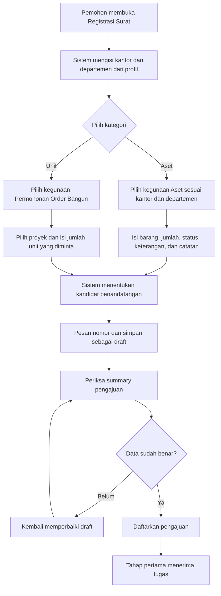
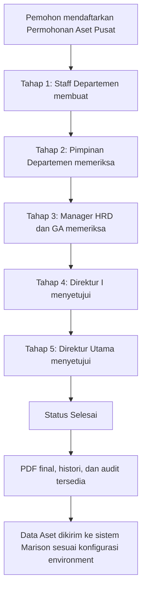
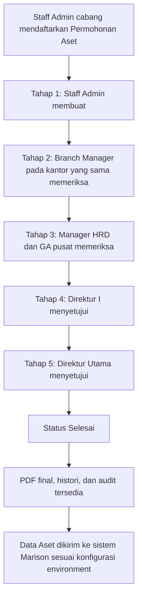
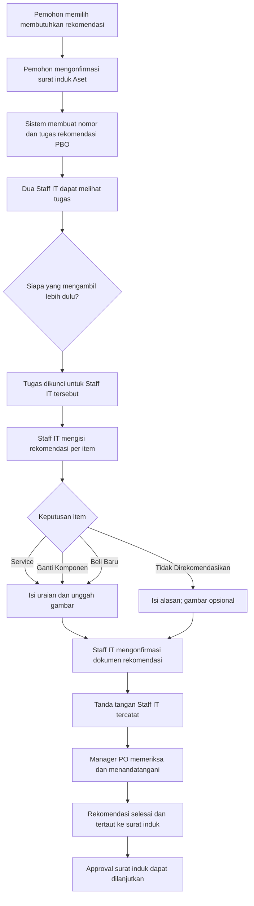
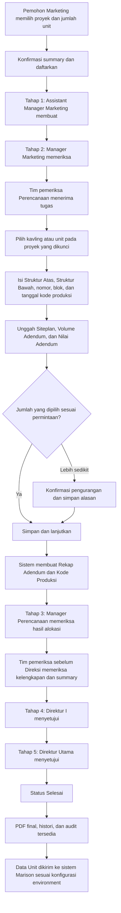
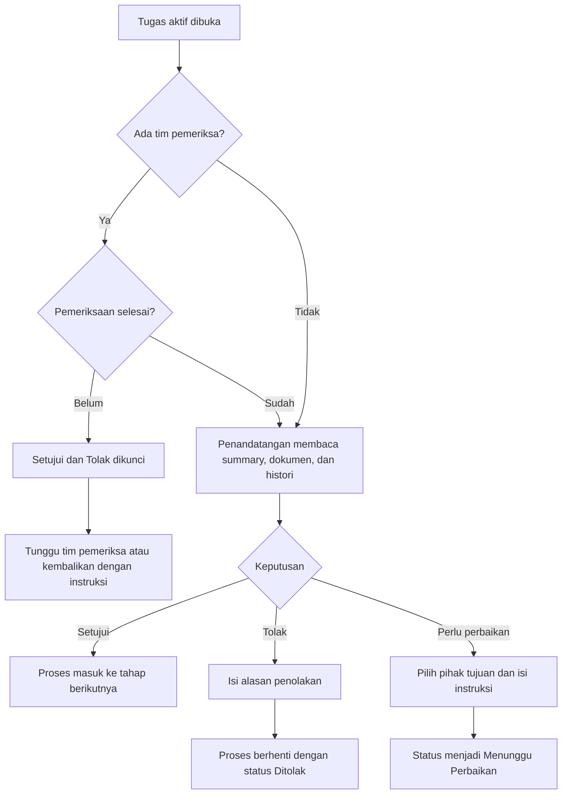
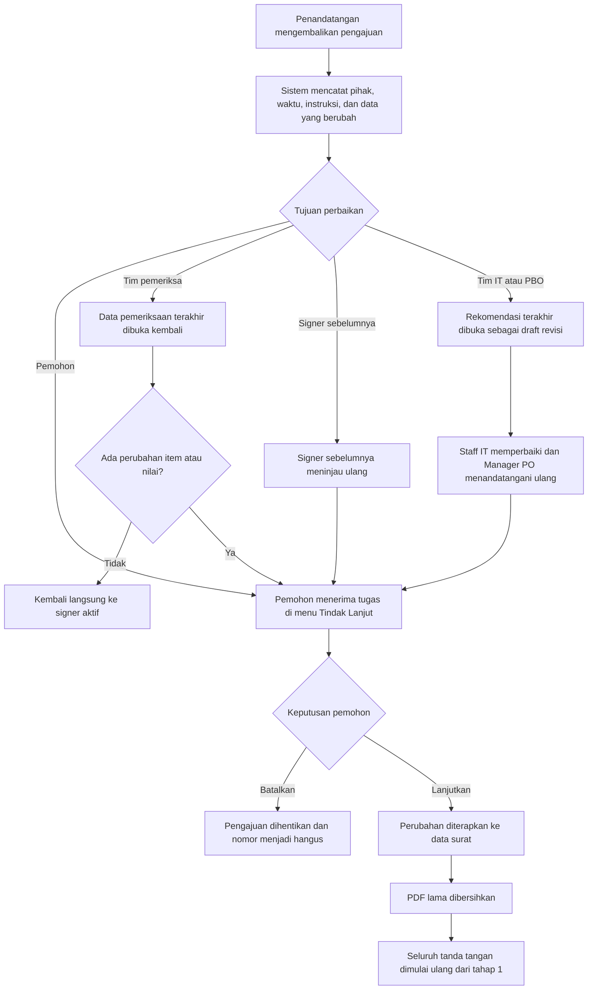

# Workflow Permohonan Aset dan Unit

Dokumen ini menjelaskan alur bisnis yang aktif berdasarkan konfigurasi production
per 22 Juli 2026. Penjelasan ditujukan untuk pemohon, tim pemeriksa,
penandatangan, admin, dan pihak yang melakukan audit.

Kategori Non Aset dan Non Unit tidak dibahas karena masih dalam pengembangan.

## Diagram PNG Transparan

Diagram berikut disediakan dalam format PNG transparan untuk presentasi,
dokumentasi, dan komunikasi lintas departemen. File sumber Mermaid berada pada
folder yang sama agar diagram dapat diperbarui bersama perubahan workflow.

| Workflow | PNG transparan | Sumber |
| --- | --- | --- |
| Permohonan Aset | [Buka PNG](./diagrams/workflow-permohonan-aset.png) | [Mermaid](./diagrams/workflow-permohonan-aset.mmd) |
| Permohonan Unit | [Buka PNG](./diagrams/workflow-permohonan-unit.png) | [Mermaid](./diagrams/workflow-permohonan-unit.mmd) |

## 1. Istilah yang Digunakan

| Istilah | Arti |
| --- | --- |
| Pemohon | User yang mengisi dan mendaftarkan pengajuan. |
| Penandatangan | Pejabat yang membuat, memeriksa, atau menyetujui dokumen pada tahap tertentu. |
| Tim pemeriksa | User yang menyiapkan atau memverifikasi data sebelum penandatangan pada tahap terkait dapat mengambil keputusan. |
| Rekomendasi Aset | Dokumen pendamping dari PBO yang memiliki nomor dan tanda tangan sendiri. |
| Tindak Lanjut | Halaman pemohon untuk menerima perubahan dan melanjutkan proses, atau membatalkan pengajuan. |
| Menunggu Perbaikan | Status ketika pengajuan dikembalikan kepada pemohon, tim pemeriksa, signer sebelumnya, atau tim rekomendasi. |
| Selesai | Seluruh persetujuan selesai dan dokumen final sudah dapat diproses ke sistem tujuan. |

## 2. Alur Umum Sebelum Pengajuan

Nomor yang sudah dipesan tetap terhubung dengan draft. Pengajuan baru aktif
setelah pemohon menekan **Data Sudah Benar, Daftarkan** pada summary.

## 3. Permohonan Aset

### 3.1 Data yang Diisi Pemohon

| Data | Keterangan |
| --- | --- |
| Kantor dan departemen | Mengikuti profil user dan tidak dapat diganti oleh user biasa. |
| Kegunaan | Sistem menampilkan Aset Pusat atau Aset Cabang sesuai kantor pemohon. |
| Daftar barang | Nama barang, satuan, jumlah, status, dan keterangan. |
| Catatan | Opsional, digunakan jika ada konteks tambahan. |
| Lampiran awal | Mengikuti konfigurasi kegunaan; dapat wajib atau opsional. |
| Rekomendasi | Hanya tersedia pada konteks PBO yang memang dikonfigurasi untuk rekomendasi. |

### 3.2 Aset Kantor Pusat

Pemimpin departemen pada tahap 2 ditentukan dari departemen pemohon. Contohnya,
pengajuan dari Perencanaan diarahkan ke Manager Perencanaan, sedangkan pengajuan
dari Marketing diarahkan ke Manager Marketing.

### 3.3 Aset Kantor Cabang atau KCP

Staff Admin dan Branch Manager dipilih dari kantor pemohon. Kandidat dari kantor
lain tidak boleh digunakan untuk pengajuan tersebut.

### 3.4 Aset yang Membutuhkan Rekomendasi PBO

Rekomendasi adalah dokumen anak dari permohonan Aset. Dokumen ini tidak dibuat
sebagai pengajuan bebas dan tidak menggantikan surat induk.

Satu dokumen rekomendasi dapat memuat banyak item. Pengisian UI tetap fokus satu
item pada satu waktu agar petugas tidak tertukar.

| Keputusan rekomendasi | Data wajib |
| --- | --- |
| Service | Nama/spesifikasi barang, uraian, dan gambar. |
| Ganti Komponen | Nama/spesifikasi barang, uraian, dan gambar. |
| Beli Baru | Nama/spesifikasi barang, uraian, dan gambar. |
| Tidak Direkomendasikan | Alasan; gambar tidak wajib. |

Item yang tidak direkomendasikan tetap tampil pada surat induk dengan garis
coret dan alasan. Riwayatnya tetap disimpan untuk audit.

## 4. Permohonan Unit

### 4.1 Data yang Diisi Pemohon

| Data | Keterangan |
| --- | --- |
| Departemen pengaju | Marketing. |
| Proyek | Wajib dipilih dan tidak dapat diganti oleh tim pemeriksa atau penandatangan. |
| Kapasitas tersedia | Ditampilkan setelah proyek dipilih agar pemohon mengetahui jumlah unit yang tersedia. |
| Jumlah unit diminta | Jumlah kebutuhan pemohon; belum menentukan kavling tertentu. |
| Lampiran awal | Opsional sesuai konfigurasi aktif. |
| Catatan | Opsional. |

Jika proyek yang dipilih salah, pengajuan harus dibatalkan dan dibuat ulang.
Proyek tidak dapat diganti di tengah proses karena menjadi identitas utama
alokasi unit.

### 4.2 Alur Utama Unit

### 4.3 Tugas Tim Pemeriksa Unit

| Posisi | Petugas aktif | Tugas |
| --- | --- | --- |
| Sebelum Manager Perencanaan | Lili Pratiwi | Memilih kavling, mengisi struktur atas/bawah, membuat data kode produksi, dan melengkapi tiga lampiran wajib. |
| Sebelum Direktur I | Tri Widyawati | Memeriksa kelengkapan hasil alokasi dan summary sebelum pengajuan masuk ke Direksi. |

Tim pemeriksa menekan **Simpan & lanjutkan** setelah pekerjaannya lengkap.
Penandatangan pada tahap terkait dapat melihat surat lebih awal, tetapi tombol
Setujui dan Tolak terkunci sampai pemeriksaan selesai.

### 4.4 Hasil Pemeriksaan Unit

Setelah pemeriksaan pertama selesai, penandatangan dapat membaca data berikut
langsung dari detail pengajuan tanpa membuka PDF:

- daftar kavling yang dipilih;
- proyek setiap kavling;
- Struktur Atas dan Struktur Bawah;
- total Struktur Atas, total Struktur Bawah, dan total nominal;
- kode produksi setiap kavling;
- Rekap Adendum Unit;
- Kode Produksi Unit;
- catatan tim pemeriksa.

Jumlah kavling boleh lebih sedikit dari jumlah yang diminta. Pengurangan harus
dikonfirmasi dan disertai alasan agar pemohon serta penandatangan memahami
perbedaannya.

## 5. Keputusan pada Setiap Tahap

## 6. Alur Perbaikan dan Tanda Tangan Ulang

Pihak tujuan perbaikan dipilih sesuai masalahnya:

| Masalah | Tujuan yang tepat |
| --- | --- |
| Data awal pemohon salah | Pemohon. |
| Kavling, struktur, kode produksi, atau lampiran Unit salah | Tim pemeriksa. |
| Keputusan atau pemeriksaan tahap sebelumnya perlu ditinjau | Penandatangan sebelumnya. |
| Spesifikasi atau rekomendasi Aset salah | Tim IT/PBO. |

Jika tim pemeriksa hanya memperbaiki data teknis tanpa mengubah item atau nilai,
proses dapat kembali langsung ke signer aktif. Jika item, jumlah, atau nilai
berubah, pemohon wajib menerima perubahan terlebih dahulu.

## 7. Status dan Notifikasi

| Kondisi | Status/badge | Penerima perhatian |
| --- | --- | --- |
| Menunggu signer | Menunggu | Signer tahap aktif. |
| Menunggu tim pemeriksa | Menunggu Pemeriksaan | Tim pemeriksa tahap aktif. |
| Pemeriksaan selesai | Terverifikasi | Signer tahap aktif. |
| Dikembalikan untuk revisi | Menunggu Perbaikan | Pihak tujuan revisi. |
| Menunggu keputusan pemohon | Tindak Lanjut | Pemohon. |
| Ditolak | Ditolak | Pemohon dan pihak yang terlibat. |
| Semua tahap selesai | Selesai | Pemohon, pihak terkait, dan proses integrasi. |

Badge sidebar dan notifikasi membantu user menemukan tugas. Detail surat tetap
menjadi sumber informasi utama untuk membaca data, alasan, dan riwayat tindakan.

## 8. Data Akhir yang Dipertahankan

Setelah proses selesai, SIGAP mempertahankan:

- nomor dan identitas surat;
- data awal pemohon;
- data hasil revisi yang disetujui;
- dokumen utama dan lampiran;
- dokumen rekomendasi aktif jika ada;
- hasil alokasi Unit dan kode produksi jika ada;
- urutan tanda tangan, waktu, keputusan, dan catatan;
- riwayat pemeriksaan dan revisi;
- PDF final;
- status pengiriman ke sistem Marison.

Data historis tidak dihapus ketika workflow atau konfigurasi berubah. Surat lama
tetap dibaca menggunakan snapshot konfigurasi pada saat surat didaftarkan.

## 9. Batasan Saat Ini

- Workflow Non Aset masih dalam pengembangan.
- Workflow Non Unit masih dalam pengembangan.
- Dokumen ini tidak menetapkan matrix baru untuk kedua kategori tersebut.
- Perubahan kandidat signer atau tim pemeriksa dilakukan melalui Kegunaan Form
  dan hanya berlaku untuk pengajuan baru; surat berjalan memakai snapshot lama.
